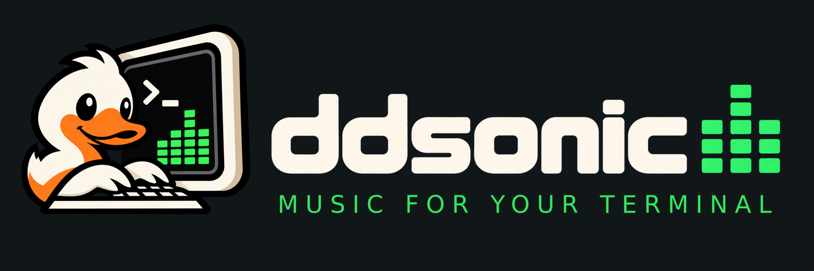
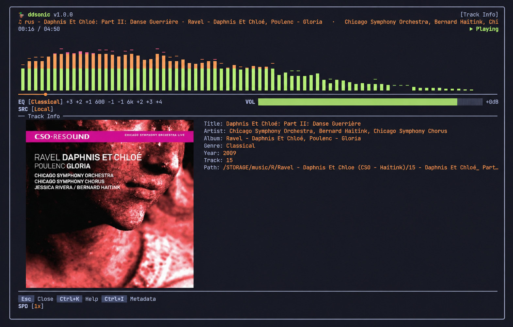

<p align="center"></p>

<p align="center"></p>

# ddsonic

**DaphnisDuck's Music Player** is a fast, terminal-first music player for Spotify, YouTube Music, local music and internet radio. It keeps a local catalog of your libraries, so browsing and search are instant and work offline, and it brings playback, the queue, lyrics, artwork, an equalizer and visualizers for all of them into one terminal interface.

ddsonic is a fork of [cliamp](https://github.com/bjarneo/cliamp), the Winamp-inspired terminal player by Bjarne Øverli. It keeps cliamp's audio engine, equalizer and visualizers, and changes how you find your music.

**ddsonic 1.1.0** is the current release, published on 2026-11-19: [release notes and downloads](https://github.com/DaphnisDuck/ddsonic/releases/tag/v1.1.0). It has a build for Linux x86-64 and a provisional build for macOS on Apple Silicon; an AUR package is planned but not in the AUR yet.

```
Music
├── All Music      Albums · Artists (Spotify, YouTube Music and Local together)
├── Spotify        Albums · Artists · Playlists · Liked Songs
├── YouTube Music  Albums from tracks · Artists from tracks · Playlists · Liked Music
├── Local          Albums · Artists · Genres · Folders · Playlists
├── Radio          Favorites · Browse Stations (cliamp radio · Countries · Genres & Tags)
└── Search
```

Each source has its own entry. All Music lists the albums and artists of Spotify, YouTube Music and Local together, each row labelled with its source. YouTube Music's rows read `YouTube · from tracks`: they are the albums and artists found in your Liked Music and synced playlists, not your saved Library Albums or the artists you follow, which ddsonic does not sync.

## Why ddsonic

- **Your music in one terminal.** Browse Spotify, YouTube Music, local music and internet radio without leaving ddsonic.
- **Instant and offline.** Your libraries are kept in a local catalog and synced in the background, so lists open at once and browsing and search work without a network. ([catalog](docs/ddsonic/catalog.md))
- **Search as you type.** `/` searches your Spotify and YouTube Music libraries, your local music and your radio stations at once, with operators such as `artist:`, `album:` and `source:local`. Rows at the end of the results search Spotify itself or the radio station directory. ([search](docs/ddsonic/search.md))
- **Keyboard all the way.** Vim-style movement, consistent navigation keys, and a bar at the bottom that lists exactly the keys that work where you are. ([navigation](docs/ddsonic/navigation.md))
- **A real player underneath.** Gapless playback, a 10-band equalizer with presets, spectrum visualizers, themes, lyrics, playback speed, shuffle and repeat, all inherited from cliamp, plus a sleep timer that fades the music out before it pauses.
- **Fits your desktop.** Media keys and desktop widgets work through MPRIS, and `ddsonic pause`, `ddsonic next`, `ddsonic status` and friends control the running player from a script or a keybinding.
- **Album artwork** beside a track's details, in Kitty and Ghostty. ([artwork](docs/ddsonic/artwork.md))

## What it plays

| Source | What you get | What it needs |
| --- | --- | --- |
| **Spotify** | Saved albums, followed artists, playlists, Liked Songs, and Spotify's own search | A Spotify Premium account |
| **YouTube Music** | Your playlists and Liked Music, and **Albums from tracks** and **Artists from tracks**: the albums and artists read from those tracks (albums may be incomplete). Saved Library Albums and followed artists are not synchronized ([details](docs/ddsonic/youtube.md#albums-from-tracks-and-artists-from-tracks-enrichment)). Live search of YouTube Music works only when it signs in with browser cookies alone; with an OAuth client configured, YouTube Music has no live search | [yt-dlp](https://github.com/yt-dlp/yt-dlp), installed by you (ddsonic does not install it; without it, YouTube is off), and a browser you are signed in to or your own Google OAuth client |
| **Local files** | Albums, artists and genres from the tags in your music folder, a folder browser that lists playable audio files (`f` shows every file), and saved playlists | Nothing; [ffmpeg](https://ffmpeg.org/) for AAC, ALAC, Opus and WMA files |
| **Internet radio** | Your favorite stations, the [Radio Browser](https://www.radio-browser.info/) directory by country or tag (its 200 most-voted stations), cliamp's radio channels, and stations you add yourself; Favorites, the channels and the directory's lists sort A–Z | Nothing |

Local files and radio need no account at all. cliamp's other sources (Navidrome, Plex, Jellyfin, SoundCloud, podcasts and more) and its Lua plugins are not part of ddsonic 1.1.

## Requirements

- **Linux on x86-64** is the supported platform. ddsonic is developed and used on Arch. The project's CI builds and tests it on Ubuntu; the 1.1.0 release was built by the project's Release workflow in its pinned build image, and was tested on Arch and Debian 13.
- **macOS** is provisional. The 1.1.0 release has a provisional build for Apple Silicon (macOS 13 or later), built by CI and qualified by hand on one Apple Silicon Mac (macOS 27) with a local file, a radio stream and a public YouTube URL; Spotify, YouTube Music and the other sources were not qualified on macOS. It is ad-hoc signed, not signed with an Apple Developer ID or notarized, and has no build attestation; its [release page](https://github.com/DaphnisDuck/ddsonic/releases/tag/v1.1.0) says how to install it and what was checked. Intel Macs are not supported and have no release build. An informational macOS CI job runs on GitHub-hosted Apple Silicon runners; it is not a required check, and some validation-tooling tests that need the Linux development shell are skipped there. This is not a statement of broad macOS support.
- **Windows** is not supported.
- **Sound** through ALSA. On PipeWire or PulseAudio, install `pipewire-alsa` or `pulseaudio-alsa` (`libasound2-plugins` on Debian).
- **Optional:** `ffmpeg` and `yt-dlp`, as in the table above. ddsonic does not install yt-dlp; when it is missing, ddsonic says how to install it and starts with YouTube off.
- **Terminal:** any modern terminal. Artwork needs Kitty or Ghostty; everywhere else, and inside tmux, ddsonic works the same without it.

## Install

**Release build**

Download `ddsonic-1.1.0-linux-amd64.tar.gz` and `SHA256SUMS` from the [1.1.0 release](https://github.com/DaphnisDuck/ddsonic/releases/tag/v1.1.0); every release is on the [Releases](https://github.com/DaphnisDuck/ddsonic/releases) page, where release candidates are marked "Pre-release". The Linux build is for x86-64 (glibc 2.36 or newer; it needs only ALSA and glibc from your system); on an Apple Silicon Mac, follow the macOS steps on the [1.1.0 release](https://github.com/DaphnisDuck/ddsonic/releases/tag/v1.1.0) page instead, which install `ddsonic-1.1.0-darwin-arm64.tar.gz` into a folder of your own. On Linux, check the download and install it (with the [GitHub CLI](https://cli.github.com/), `gh attestation verify ddsonic-1.1.0-linux-amd64.tar.gz --repo DaphnisDuck/ddsonic` also checks the build's provenance):

```sh
sha256sum -c --ignore-missing SHA256SUMS
tar -xzf ddsonic-*-linux-amd64.tar.gz
install -Dm755 ddsonic-*-linux-amd64/ddsonic ~/.local/bin/ddsonic
```

The archive also holds a launcher entry and ddsonic's icon in `share/`. To have ddsonic in your application menu, copy them and point the entry at the executable you installed:

```sh
cp -r ddsonic-*-linux-amd64/share/. ~/.local/share/
sed -i "s|^Exec=ddsonic\$|Exec=\"$HOME/.local/bin/ddsonic\"|" ~/.local/share/applications/ddsonic.desktop
```

The entry as shipped starts `ddsonic` from the `PATH` of your desktop session, which often lacks `~/.local/bin`; the second line gives it the full path, in quotes so that a space in it is harmless. (If your home folder's name holds a `$`, a quote, a backtick, a backslash or a `%`, edit the `Exec=` line by hand: the [Desktop Entry rules](https://specifications.freedesktop.org/desktop-entry-spec/latest/exec-variables.html) say how each is written.)

To update, install a newer release's archive the same way. ddsonic does not update itself.

**AUR**

An AUR package, `ddsonic-bin`, is planned; it is not in the AUR yet.

**From source**

You need [Go](https://go.dev/dl/) 1.26.6 or later (ddsonic is built and tested with 1.27.4), a C compiler, `pkg-config`, and the ALSA and codec headers:

```sh
# Debian/Ubuntu
sudo apt install build-essential pkg-config libasound2-dev libflac-dev libvorbis-dev libogg-dev libmpg123-dev
# Arch
sudo pacman -S base-devel alsa-lib flac libvorbis libogg mpg123
```

```sh
git clone https://github.com/DaphnisDuck/ddsonic.git
cd ddsonic
make install            # builds ./ddsonic and installs it to ~/.local/bin/ddsonic
```

`make install` also adds a launcher entry and ddsonic's icon under `~/.local/share`, so ddsonic appears in your application menu and opens in a terminal.

To update, `git pull && make install`.

Build with `make build` or `make install`. A plain `go build` or `go install .` names the executable `cliamp`, because ddsonic keeps cliamp's Go module path; `go build -o ddsonic .` is the plain Go equivalent.

**Coming from ddmus**

ddsonic was called ddmus until its first release candidate. `v1.0.0-rc.1` was published under that name and stays as it was: its files are `ddmus-1.0.0-rc.1-…`, its executable is `ddmus`, and it keeps its files in `ddmus` folders. To bring those over to ddsonic, see [moving from ddmus](https://github.com/DaphnisDuck/ddsonic/blob/main/docs/ddsonic/files.md#moving-from-ddmus-100-rc1-and-earlier).

## Quick start

```sh
ddsonic setup             # Spotify, YouTube Music and your music folder; each is optional
ddsonic                   # open the library
```

With nothing set up, ddsonic still opens with Local (your `~/Music` folder) and Radio. With Spotify set up and not signed in yet, the library's heading reads `Spotify sign-in required`: open **Spotify**, press `Enter` on **Sign in to Spotify**, and finish in your browser. Your library syncs as soon as you have signed in. You can also start with files: `ddsonic ~/Music/some-album` loads a folder into the queue.

In the library:

| Key | Action |
| --- | --- |
| `j` `k` | Move down, up |
| `l` `Enter` | Open, or play |
| `h` `Esc` | Back (never quits) |
| `g` `G` | Top, bottom |
| `/` | Search |
| `Space` | Play or pause |
| `p` `n` | Previous, next track |
| `Tab` | Switch between the library and the queue |
| `r` | Sync the source you're browsing |
| `Z` | Sleep timer: 15, 30, 45, 60, 90 minutes (configurable), off |
| `q` | Quit, from any screen |

Choosing a track plays its album or playlist from that track. `Tab` shows the queue, where you can shuffle, repeat, reorder, open track info (`i`) and lyrics (`y`), and change the equalizer, visualizer and speed. In the queue, Enter plays the selected track, `/` filters, `r` cycles repeat, `x` removes a track and `X` clears the whole queue; `Ctrl+Z` brings it back until the queue next changes. The sleep timer (`Z`) shows the time left in the header, fades the music out (30 seconds by default; `sleep_fade_seconds` in the `[ddsonic]` table sets it) and then pauses; `Space` resumes. In Local > Folders, `f` switches between audio files only and every file. Where you are typing (search, the queue filter), letters such as `q` are text. Every screen lists its keys at the bottom; the complete tables are in [docs/ddsonic/navigation.md](docs/ddsonic/navigation.md).

## Configuration

ddsonic reads `~/.config/ddsonic/config.toml`. `ddsonic setup` writes the parts it asks about and leaves the rest of the file alone.

- **Spotify:** `ddsonic setup` offers a choice between your own Spotify Developer app, which is recommended, and a shared client that is rate-limited more often. [docs/spotify.md](docs/spotify.md) shows how to create the app. `ddsonic spotify reset` signs you out.
- **YouTube Music:** browser cookies or your own Google OAuth client; see [docs/ddsonic/youtube.md](docs/ddsonic/youtube.md).
- **Local music:** one folder is indexed: `initial_directory` in `config.toml`, else `$XDG_MUSIC_DIR`, else `~/Music`. Only changed files are reread at each start.
- **Radio:** add your own stations in `~/.config/ddsonic/radios.toml`; see [Custom Radio Stations](docs/configuration.md#custom-radio-stations).
- **Lyrics:** looked up on LRCLIB over HTTPS. The NetEase fallback is off by default because it sends the artist and title over unencrypted HTTP; `netease_lyrics = true` in the `[ddsonic]` table turns it on. Without it, "No lyrics found" can mean a song's lyrics are only on NetEase; "Lyrics service unavailable" means LRCLIB could not be reached, and `r` in the lyrics view tries again ([lyrics](docs/ddsonic/lyrics.md)).
- **How often sources sync, artwork and the border:**

  ```toml
  [ddsonic]
  # how old the last sync may get before the next start syncs again; "0s" is every start
  spotify_refresh = "2h"
  youtube_refresh = "2h"
  artwork = true
  border = true
  ```

## Documentation

| Topic | Where |
| --- | --- |
| Navigation and every key | [docs/ddsonic/navigation.md](docs/ddsonic/navigation.md) |
| Search and its query language | [docs/ddsonic/search.md](docs/ddsonic/search.md) |
| The catalog: what is stored, when it syncs, Spotify rate limits | [docs/ddsonic/catalog.md](docs/ddsonic/catalog.md) |
| YouTube Music setup | [docs/ddsonic/youtube.md](docs/ddsonic/youtube.md) |
| Album artwork and terminals | [docs/ddsonic/artwork.md](docs/ddsonic/artwork.md) |
| How ddsonic uses the window | [docs/ddsonic/layout.md](docs/ddsonic/layout.md) |
| Files and folders, running beside cliamp, moving from ddmus (1.0.0-rc.1 and earlier) | [docs/ddsonic/files.md](docs/ddsonic/files.md) |
| 1.1.0: release notes, known limitations, files and checksums, macOS install | [1.1.0 release](https://github.com/DaphnisDuck/ddsonic/releases/tag/v1.1.0) |
| Release history | [CHANGELOG.md](CHANGELOG.md) |
| Reporting a security problem | [SECURITY.md](SECURITY.md) |

`ddsonic --help` lists every command and option.

The other files in [docs/](docs/) are cliamp's own documentation, not yet adapted to ddsonic. Read `ddsonic` and `~/.config/ddsonic` where they say `cliamp` and `~/.config/cliamp`. Some still apply in part:

- [Audio settings](docs/audio-quality.md).
- [Themes](docs/themes.md): the theme files and settings apply. Choose a theme with `--start-theme` or `ddsonic theme`; the `t` picker described there is not in ddsonic.
- [Local playlists](docs/playlists.md): the file format and the `ddsonic playlist` commands apply. The playlist-manager keys described there do not.
- [Remote control](docs/remote-control.md): applies, except the `mono` operation and the plugin operations, which ddsonic does not have.

Their pages on other providers, plugins, headless mode and keybindings describe cliamp, not ddsonic.

## Troubleshooting

- **"audio output unavailable":** ALSA cannot reach your sound server. Install `pipewire-alsa` or `pulseaudio-alsa`.
- **Some local files won't play:** AAC, ALAC, Opus and WMA need `ffmpeg`.
- **YouTube Music is empty or won't play:** it needs `yt-dlp`, which you install yourself, and a working sign-in; [docs/ddsonic/youtube.md](docs/ddsonic/youtube.md) covers the usual causes.
- **Spotify says "rate limited until …":** Spotify has asked ddsonic to wait. Until that time ddsonic sends Spotify's Web API nothing, so syncs, searches and album opens fail at once; a failed sync retries when the wait ends, and the wait is kept across restarts. "quota exceeded (no reset time given)" pauses automatic sync until a sync you start with `r` (or signing in) succeeds. See [docs/ddsonic/catalog.md](docs/ddsonic/catalog.md).
- **The log** is `~/.config/ddsonic/ddsonic.log`; `--log-level debug` says more.

## Project status

ddsonic 1.1.0, the current release, was published on 2026-11-19; its [release page](https://github.com/DaphnisDuck/ddsonic/releases/tag/v1.1.0) has the notes, the known limitations (among them Spotify memory use in long sessions, and a brief stutter on pause and resume) and the files. The first stable release, 1.0.0, was released on 2026-10-31. Release candidates and releases are listed on the [Releases](https://github.com/DaphnisDuck/ddsonic/releases) page, and [CHANGELOG.md](CHANGELOG.md) says what each changes. The project's website is [ddsonic.app](https://ddsonic.app); this repository holds the code, the issues and the releases. From 1.0 on, a newer 1.x opens the config and catalog of an older one; going back to an older version is not supported. The catalog (`~/.local/share/ddsonic/library.db`) can always be deleted and rebuilt by a sync; your sign-ins and settings live in `~/.config/ddsonic`.

ddsonic is maintained by one person. Bug reports are welcome in [Issues](https://github.com/DaphnisDuck/ddsonic/issues), which is also where planned and proposed work is tracked.

## Lineage and thanks

ddsonic would not exist without **[Bjarne Øverli](https://github.com/bjarneo)**, who created [cliamp](https://github.com/bjarneo/cliamp), and everyone who has [contributed to it](https://github.com/bjarneo/cliamp/graphs/contributors). Nearly everything that makes ddsonic sound good is their work: the audio engine, the equalizer, the visualizers and the provider integrations. If you enjoy ddsonic, please star, use and support cliamp, and visit cliamp's website, [cliamp.stream](https://cliamp.stream).

ddsonic adds the library, the catalog, search and the layout on top, and follows cliamp's development: see [docs/ddsonic/upstream.md](docs/ddsonic/upstream.md). It keeps its own config, data and media-key name, so both can be installed side by side.

Both build on [Bubble Tea](https://github.com/charmbracelet/bubbletea), [Lip Gloss](https://github.com/charmbracelet/lipgloss), [Beep](https://github.com/gopxl/beep) and [go-librespot](https://github.com/devgianlu/go-librespot); the catalog uses [modernc.org/sqlite](https://gitlab.com/cznic/sqlite).

## License

ddsonic's source code is MIT-licensed, the same as cliamp: see [LICENSE](LICENSE). The original copyright belongs to Bjarne Øverli.

The `ddsonic` executable is a different matter. It links [go-librespot](https://github.com/devgianlu/go-librespot), which is GPL-3.0, so the executable as a whole is distributed under **GPL-3.0** ([LICENSE-GPL-3.0](LICENSE-GPL-3.0)). Each release carries the complete corresponding source (for 1.1.0, `ddsonic-1.1.0-source.tar.gz`) and a `THIRD_PARTY_NOTICES` file listing everything linked in, with its license; a provisional macOS build adds the codec sources and build scripts it used (`ddsonic-1.1.0-darwin-arm64-build-sources.tar.gz`). [docs/ddsonic/releasing.md](docs/ddsonic/releasing.md) describes the release build.

The only official binaries are those published on this repository's [Releases](https://github.com/DaphnisDuck/ddsonic/releases) page, and the AUR package `ddsonic-bin` built from them once it exists. The Linux files of `v1.1.0` have a build attestation from the release workflow. Its macOS files have none and cannot be reproduced from the tag alone. `v1.0.0` has no build attestation: it was built locally, not by the release workflow, and its release page says which source it was built from. If you distribute a modified ddsonic, please give it another name.

**Name and artwork.** The software licenses above apply to ddsonic's code, not to the ddsonic name, logo, or icon artwork. The branding assets may be redistributed with ddsonic and with packages or distributions of ddsonic, including technical transformations such as resizing, format conversion, and optimization required for packaging or presentation. This permission does not grant permission to use the ddsonic name, logo, or icons to identify a modified or unrelated project. The script that assembles the artwork, [`assets/branding/source/build.py`](assets/branding/source/build.py), is code and is MIT-licensed like the rest.

ddsonic comes with no warranty; use it at your own risk.
